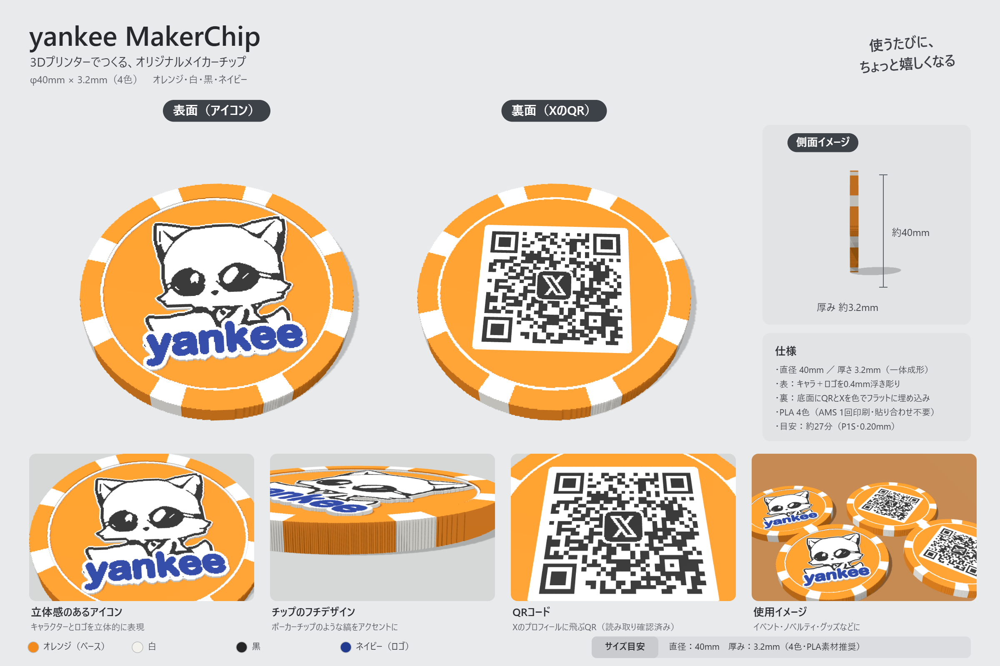

# yankee MakerChip

3Dプリンターでつくる、ポーカーチップ風のオリジナルメイカーチップです。
**直径40mm × 厚さ3.2mm／PLA 4色／一体成形（貼り合わせ不要）**で、AMSを使えば1回で印刷できます。



## ダウンロード

| ファイル | 内容 |
|---|---|
| [`yankee_MakerChip_Bambu.3mf`](yankee_MakerChip_Bambu.3mf) | **Bambu Studio用プロジェクト（4色の割り当て済み）★おすすめ** |
| [`STL/chip_0_orange.stl`](STL/chip_0_orange.stl) | オレンジ（本体・ベース） |
| [`STL/chip_1_white.stl`](STL/chip_1_white.stl) | 白（キャラ・フチの縞・QRの白地） |
| [`STL/chip_2_black.stl`](STL/chip_2_black.stl) | 黒（キャラの線・QR・Xマーク） |
| [`STL/chip_3_navy.stl`](STL/chip_3_navy.stl) | ネイビー（yankeeロゴ） |

一式をまとめて落とすときは、このページ上部の **Code → Download ZIP** を使ってください。

## 構造

| 高さ | 内容 |
|---|---|
| 2.8〜3.2mm | **表面**：キャラとyankeeロゴを0.4mm浮き彫り |
| 0.4〜2.8mm | **本体**：オレンジ（フチの白い縞は上から下まで貫通） |
| 0.0〜0.4mm | **底面（裏面）**：QRコードとXのエンブレムを、色で平らに埋め込み |

QRコードは、印刷したチップを裏返したときに正しく読める向きで作っています（リンク先：https://x.com/yankee_sns ）。

<p>


</p>

## 印刷方法

### A. Bambu Studio（おすすめ）
1. `yankee_MakerChip_Bambu.3mf` を開く
2. プリンターがP1S以外なら、上部のプリンター選択で機種を切り替える
3. AMSのスロットに **1=オレンジ／2=白／3=黒／4=ネイビー** の順で入れ、フィラメント一覧の色と合わせる
4. スライスして印刷（参考：P1S・0.4mmノズル・0.20mm Standard・PLAで約27分、色替え21回）

### B. STLから（他のスライサー）
1. `STL/` の4ファイルをまとめて読み込む
2. 「1つのオブジェクト（マルチパーツ）として読み込む」を選ぶ（4つとも同じ座標系なので、位置はずらさない）
3. 各パーツに色を割り当てて印刷

### おすすめ設定・注意
- 積層ピッチ 0.2mm（底面のQRが2層、表面の浮き彫りが2層になります）
- ノズル 0.4mm 以下（QRの1マス 0.6mm、最も細い線 約0.4mm）
- **ブリムなし**（底面がQRなので跡が残ります）／サポート不要
- プレートは脱脂しておく。テクスチャPEIなら底面はザラっと、スムースプレートならツルッとした質感になります
- 最初に1枚試し刷りして、スマホでQRが読めるか確認してください

## 仕様

| 項目 | 内容 |
|---|---|
| サイズ | 直径 40mm／厚さ 3.2mm |
| 色 | オレンジ（ベース）・白・黒・ネイビー（ロゴ） |
| 素材 | PLA推奨 |
| QRコード | バージョン4／誤り訂正レベルH（約30%欠けても読める）、中央にXのエンブレム |

## データの作り直し（`generator/`）

`generator/` には、このデータを作ったスクリプトと元画像が入っています（Windows PowerShell 5.1で動作）。

```powershell
cd generator
powershell -ExecutionPolicy Bypass -File make_chip.ps1          # STL を生成（onepiece/ に出力）
powershell -ExecutionPolicy Bypass -File make_bambu_3mf.ps1     # Bambu Studio用 3MF を生成（Bambu Studio が必要）
```

`make_chip.ps1` の引数で、QRのリンク先（`-Url`）、QRのマスの大きさ（`-QrModule`）、Xの大きさ（`-XSize`、`-XBadge`）、ロゴの大きさ（`-TextScale`）などを変えられます。
